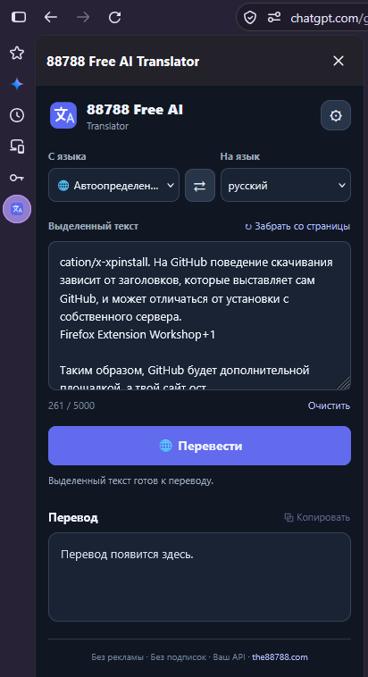

# 88788 Free AI Translator

[English](#english) · [Русский](#русский) · [简体中文](#简体中文)

**v0.4.1 · Firefox 140+ · Mozilla Signed & Approved · October 15, 2026**

[Official website / Официальный сайт / 官方网站](https://translator.the88788.com/) · [Download / Скачать / 下载](https://github.com/The88788/88788-free-ai-translator/releases/tag/v0.4.1) · [Privacy](PRIVACY.md) · [Changelog](CHANGELOG.md)



## English

Free, open-source Firefox extension for translating selected webpage text in the sidebar using your own OpenAI-compatible API. No advertisements, subscriptions or analytics in the extension.

### Features

- 75 translation languages; English and Russian interface.
- Connect OpenRouter, Groq, Gemini, FreeLLMAPI or another compatible Chat Completions API.
- Choose a model or routing preset; see the actual model and provider when reported by the API.
- Local translation cache: up to 200 entries for up to 30 days, including model and provider information.
- Automatic retries for temporary API errors.
- Request another translation with FreeLLMAPI, bypassing the cache. A different model is best effort and depends on routing.
- Signed XPI for independent distribution; automatic updates use the official website.

### Install and configure

1. Download `88788-free-ai-translator-0.4.1.xpi` from [Releases](https://github.com/The88788/88788-free-ai-translator/releases/tag/v0.4.1) and open it in Firefox 140+, or use the official website.
2. Open the extension sidebar and click the settings gear.
3. Choose the API type; enter the provider's API base URL, API key and model or route. For FreeLLMAPI, use the route configured on your gateway, such as `auto:default`.
4. Save settings and grant access to the selected API host.
5. Select webpage text and click **Translate**.

An API key from a compatible provider is required for authenticated services; local gateways may allow an empty key. Free usage depends on provider quotas. The extension sends selected text to your configured API only when you request translation. Settings, credentials and cache are stored locally in Firefox. See [Privacy](PRIVACY.md).

> ### IT services by 88788
> Need a website, extension or application? **88788** offers website development and ongoing maintenance, server administration, browser extension and application development, and other IT services. From a new project to support for an existing system, discuss your requirements directly with the developer.
>
> **Contact and project enquiries: [the88788.com](https://the88788.com/)**

## Русский

Бесплатное расширение Firefox с открытым исходным кодом для перевода выделенного текста в боковой панели через собственный OpenAI-совместимый API. В расширении нет рекламы, подписок и аналитики.

### Возможности

- 75 языков перевода; интерфейс на русском и английском.
- Подключение OpenRouter, Groq, Gemini, FreeLLMAPI и других совместимых Chat Completions API.
- Выбор модели или маршрута; отображение фактической модели и провайдера, если API сообщает эти сведения.
- Локальный кеш до 200 переводов на срок до 30 дней, включая сведения о модели и провайдере.
- Автоматические повторные запросы при временных ошибках.
- Альтернативный перевод через FreeLLMAPI с обходом кеша. Смена модели зависит от маршрутизации и не гарантируется.
- Подписанный XPI для независимого распространения; автоматические обновления через официальный сайт.

### Установка и настройка

1. Скачайте `88788-free-ai-translator-0.4.1.xpi` из [Releases](https://github.com/The88788/88788-free-ai-translator/releases/tag/v0.4.1) и откройте в Firefox 140+ либо воспользуйтесь официальным сайтом.
2. Откройте боковую панель расширения и нажмите шестерёнку настроек.
3. Выберите тип API, укажите базовый URL, API-ключ и модель или маршрут. Для FreeLLMAPI используйте маршрут своего шлюза, например `auto:default`.
4. Сохраните настройки и разрешите доступ к выбранному API-серверу.
5. Выделите текст на странице и нажмите **Перевести**.

Для сервисов с авторизацией нужен API-ключ совместимого провайдера; локальный шлюз может работать без ключа. Бесплатные квоты зависят от провайдера. Выделенный текст отправляется выбранному API только по запросу перевода. Настройки, ключ и кеш хранятся локально в Firefox. Подробнее: [политика конфиденциальности](PRIVACY.md).

> ### Разработка и IT-услуги от 88788
> Нужен сайт, расширение или приложение? **88788** предлагает разработку и ведение сайтов, администрирование серверов, создание браузерных расширений и приложений, а также другие IT-услуги. Новый проект, развитие существующего решения или техническое сопровождение — обсудите задачу напрямую с разработчиком.
>
> **Контакты и обсуждение проектов: [the88788.com](https://the88788.com/)**

## 简体中文

免费、开源的 Firefox 扩展，可通过您自己的 OpenAI 兼容 API，在侧边栏翻译网页中选中的文本。扩展内无广告、订阅或分析追踪。

### 功能

- 支持 75 种翻译语言；界面提供英语和俄语。
- 可连接 OpenRouter、Groq、Gemini、FreeLLMAPI 及其他兼容的 Chat Completions API。
- 可选择模型或路由；API 提供相关信息时，显示实际使用的模型和服务商。
- 本地缓存最多保存 200 条翻译，最长保留 30 天，同时保存模型和服务商信息。
- 临时 API 错误自动重试。
- FreeLLMAPI 支持跳过缓存重新翻译；是否更换模型取决于路由，无法保证。
- 提供 Mozilla 签名的 XPI 安装包，支持独立分发，并通过官方网站自动更新。

### 安装与设置

1. 从 [Releases](https://github.com/The88788/88788-free-ai-translator/releases/tag/v0.4.1) 下载 `88788-free-ai-translator-0.4.1.xpi`，并在 Firefox 140+ 中打开；也可通过官方网站安装。
2. 打开扩展侧边栏，点击设置齿轮。
3. 选择 API 类型，填写 API 基础 URL、密钥以及模型或路由。FreeLLMAPI 请使用网关中配置的路由，例如 `auto:default`。
4. 保存设置，并允许扩展访问所选 API 服务器。
5. 选中网页文本，点击翻译按钮。

需要身份验证的服务必须使用兼容服务商提供的 API 密钥；本地网关可能无需密钥。免费额度取决于服务商。只有在您请求翻译时，选中的文本才会发送到您配置的 API。设置、密钥和缓存保存在 Firefox 本地。详情见[隐私政策](PRIVACY.md)。

> ### 88788 的 IT 服务
> 需要网站、浏览器扩展或应用程序？**88788** 提供网站开发与持续维护、服务器管理、浏览器扩展和应用程序开发，以及其他 IT 服务。无论是新项目、现有系统升级还是技术维护，都欢迎直接联系开发者讨论需求。
>
> **联系与项目咨询：[the88788.com](https://the88788.com/)**

---

## Development

Plain HTML, CSS and JavaScript; no build step or dependencies. The root `manifest.json` matches the signed v0.4.1 package (`translator@the88788.com`, Firefox 140+, official update URL). Mozilla signature files are only in the distributed XPI; source archives are unsigned.

```sh
node tests/api.test.mjs
node tests/cache.test.mjs
node tests/localization.test.mjs
node tests/languages.test.mjs
```

Load `manifest.json` via `about:debugging#/runtime/this-firefox` for temporary development installation. Keep the extension ID when updating. See [technical notes](docs/DEVELOPMENT.md), [review notes](AMO_REVIEW_NOTES.md) and [MIT license](LICENSE).
